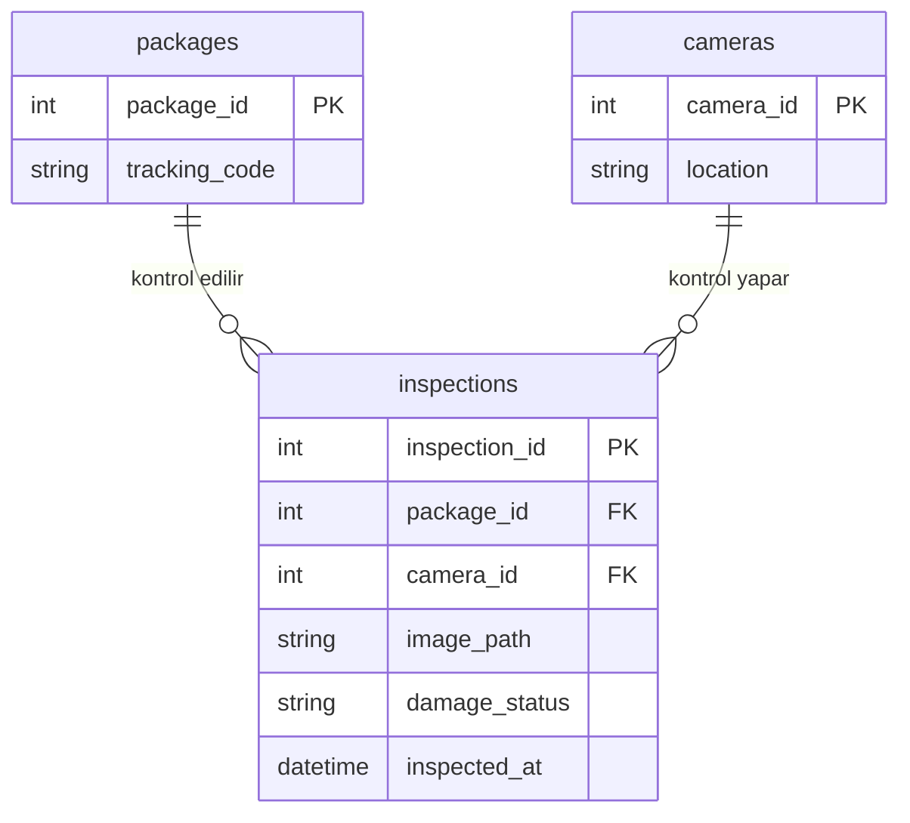

# Kargo Hasar Kontrol Sistemi

**Veritabanı Yönetim Sistemleri — Vize Çalışması ve Ödev 2**

Bu depoda, lojistik alanında kargo kutularının sağlam veya hasarlı durumunu incelemeye yönelik bir proje senaryosu ve bu senaryoyla bağlantılı veritabanı ders çalışmaları bulunmaktadır.

**İki çalışma birbirinden farklıdır:**

| Çalışma | Konu | Kullanılan dosya / veri |
|---|---|---|
| **Vize** | Görüntü veri setini tanıma ve temel SQL ile sayısal analiz | Ana klasördeki `sorgular.sql`; 581 görüntüye ait özet sayılar |
| **Ödev 2** | JOIN, görev sayımı, fan-out hatası, ERD ve normalizasyon | `odevler/odev-02/sorgular.sql`; dersin `robot_fleet` örnek veritabanı ve kendi proje tasarımımız |

> **Önemli:** `robot_fleet`, hocanın JOIN soruları için verdiği örnek veritabanıdır. Kargo görüntüsü veri setiyle aynı şey değildir. Kendi kargo projemizin üç tablosu henüz PostgreSQL'de oluşturulmamıştır.

## 1. Projenin Amacı ve Senaryosu

- **Alan:** Logistics & Delivery (Lojistik ve Teslimat)
- **Planlanan sistem:** Computer Vision Camera (Görüntü İşleyen Kamera)
- **Yapay zekâ konusu:** Anomaly Detection (Anomali Tespiti)

Amaç, kargo kutularının görüntülerini kullanarak sağlam (`intact`) ve hasarlı (`damaged`) durumlarını ayırt etmeye yönelik bir sistem tasarlamaktır. Hasarlı kutular anormal durum olarak değerlendirilecektir.

Bu aşamada bir görüntü işleme modeli eğitilmemiş ve kargo kontrol uygulaması kurulmamıştır. Veri kaynağı, sınırlamalar ve planlanan veri hikâyesi için [VERI_KARTI.md](VERI_KARTI.md) ve [SCENARIO.md](SCENARIO.md) dosyalarına bakılabilir.

## 2. Kullanılan Görüntü Veri Seti

- **Adı:** Damaged Intact Box Dataset, v1
- **Kaynak:** [Roboflow Universe — Damaged Intact Box Dataset](https://universe.roboflow.com/damages-intact-box-dataset/damaged-intact-box-dataset/dataset/1)
- **Lisans:** CC BY 4.0
- **Biçim:** JPG; görüntüler 640 × 640 piksel

| Bölüm | Sağlam (`intact`) | Hasarlı (`damaged`) | Toplam |
|---|---:|---:|---:|
| train | 228 | 184 | 412 |
| valid | 61 | 52 | 113 |
| test | 36 | 20 | 56 |
| **Toplam** | **325** | **256** | **581** |

Veri setinde kargo takip numarası, kamera kimliği veya teslimat adresi bulunmaz. Görüntülerin gerçek bir lojistik deposunda çekildiği de doğrulanmamıştır. Bu yüzden aşağıdaki kamera ve kargo tabloları **mevcut veri değil, geleceğe yönelik veritabanı tasarımıdır**.

## 3. Dosyalar Nerede?

```text
proje/
├── README.md                         # Bu açıklama dosyası
├── VERI_KARTI.md                     # Vizede kullanılan görüntü veri seti
├── sorgular.sql                      # Vize: 6 temel SQL sorgusu
├── SCENARIO.md                       # Kargo projesinin veri hikâyesi
├── AI_BEYAN.md                       # Yapay zekâ kullanım beyanı
└── odevler/
    └── odev-02/
        ├── sorgular.sql              # Ödev 2: 5 JOIN/hesaplama sorusu
        └── rapor.md                  # Ödev 2: bir sayfalık rapor
```

GitHub'da dosyaları görmek için `odev-02` dalını seçin. İsterseniz **Code → Download ZIP** ile dosyaları bilgisayarınıza indirebilir veya Git ile projeyi açabilirsiniz.

## 4. Vize Çalışması: Ne Yaptık?

Vizede kutuların görüntülerini doğrudan SQL ile okumadık. İndirilen veri setindeki klasörlerden elde edilen görüntü sayılarını kullanarak **altı temel sorgu** hazırladık.

Amaç; `SELECT`, `WHERE`, `COUNT`, `SUM`, `GROUP BY`, `WITH` ve `VALUES` gibi temel SQL ifadelerini öğrenmek ve veri setini sayılarla tanımaktı.

### 4.1 Vize SQL sorguları nasıl çalıştırılır?

1. Bilgisayarda **Visual Studio Code (VS Code)** ve **PostgreSQL** kurulu olmalıdır. VS Code'un PostgreSQL eklentisiyle sorgu çalıştırılabilir.
2. Projenin ana klasöründeki **`sorgular.sql`** dosyasını açın. `odevler/odev-02/sorgular.sql` dosyası farklı bir ödev içindir.
3. VS Code'da PostgreSQL bağlantısını seçin (örneğin önceden oluşturulmuş `llm_ops` veya kullanılabilir başka bir PostgreSQL veritabanı). Vize sorguları mevcut bir tabloya ihtiyaç duymaz.
4. **Soru 1** altındaki `SELECT 325 + 256 AS toplam_goruntu;` satırını seçip PostgreSQL eklentisindeki **Run Query / Execute Query** komutunu kullanın.
5. **Soru 2** için yüzdelik hesabını içeren `SELECT ROUND(256.0 * 100 / 581, 2) AS hasarli_orani;` sorgusunu aynı şekilde çalıştırın.
6. **Soru 3–6** için sorgunun tamamını, `WITH veri(...) AS (` satırından son `;` işaretine kadar seçin. Yalnızca alttaki `SELECT` bölümünü seçerseniz geçici `veri` tanımı eksik kalır.
7. Çıktıyı aşağıdaki beklenen sonuçlarla karşılaştırın. `GROUP BY` sorgularında satır sırası farklı olabilir.

| Soru | Ne hesaplıyor? | Beklenen sonuç |
|---|---|---|
| 1 | Toplam görüntü | 581 |
| 2 | Hasarlı görüntü oranı | %44,06 |
| 3 | Özet kayıt ve görüntü sayısı | 6 özet satır; toplam 581 görüntü |
| 4 | Hasarlı görüntü sayısı | 256 |
| 5 | Etikete göre görüntüler | `intact`: 325; `damaged`: 256 |
| 6 | Bölümlere göre görüntüler | train: 412; valid: 113; test: 56 |

**Dikkat:** `WITH` ve `VALUES`, sorgu içinde geçici özet veriler tanımlar; kalıcı tablo oluşturmaz. Üçüncü sorudaki `COUNT(*) = 6` değeri görüntü sayısı değil, **özet satır sayısıdır**. Toplam 581 görüntüyü `SUM(adet)` verir.

**Doğrulama durumu:** Vize çalışması sırasında ilk iki hesaplama sorgusu PostgreSQL bağlantısı üzerinde çalıştırılarak kontrol edildi. Diğer sorguların beklenen sonuçları veri kartındaki sayılara göre hesaplandı ve kodları gözden geçirildi; hepsinin o aşamada ayrı ayrı çalıştırıldığı iddia edilmiyor.

## 5. Ödev 2: JOIN, ERD ve Normalizasyon

Bu ödevde iki farklı iş yaptık:

1. Hocanın verdiği **`robot_fleet`** veritabanında robotlar, operatörler ve görevler arasındaki ilişkileri sorguladık.
2. Kendi **kargo hasar kontrol projemiz** için bir ERD çizdik, normalizasyonu açıkladık ve ileride kullanılabilecek iki JOIN sorusu tasarladık.

### 5.1 Ödev 2 için gerekenler

- PostgreSQL ve Windows'ta **SQL Shell (psql)**; alternatif olarak PostgreSQL'e bağlı bir SQL editörü
- SQL dosyasını açmak için VS Code veya başka bir metin düzenleyici
- Hocanın örnek verisi: [robot_fleet.sql](https://github.com/gizemturker/blp105-course/blob/main/data/robot_fleet.sql)
- Bizim çözümümüz: [odevler/odev-02/sorgular.sql](odevler/odev-02/sorgular.sql)

### 5.2 `robot_fleet` veritabanını kurma — adım adım

**Bu kurulum yeni başlayacak kişi içindir. Veritabanı zaten yüklüyse yeniden yüklemek zorunda değilsiniz.**

1. Yukarıdaki `robot_fleet.sql` bağlantısını açın. GitHub'daki **Raw** seçeneğiyle dosyayı bilgisayarınıza, örneğin `Downloads` klasörüne, `robot_fleet.sql` adıyla kaydedin.
2. Windows Başlat menüsünden **SQL Shell (psql)** programını açın. Sunucu ve port sorularında kendi PostgreSQL kurulumunuzun bilgilerini kullanın. İlk bağlantı için `postgres` veritabanını seçebilirsiniz; kullanıcı adınız ve şifreniz kendi kurulumunuza göre değişebilir.
3. `robot_fleet` veritabanınız **yoksa** aşağıdaki SQL komutunu çalıştırın:

   ```sql
   CREATE DATABASE robot_fleet;
   ```

4. Ardından veritabanına geçin:

   ```text
   \c robot_fleet
   ```

5. İndirdiğiniz örnek veri dosyasını yükleyin. Aşağıdaki `KULLANICI` kısmını ve dosya yolunu kendi bilgisayarınıza göre değiştirin:

   ```text
   \i 'C:/Users/KULLANICI/Downloads/robot_fleet.sql'
   ```

6. Dosya başarıyla çalıştıktan sonra tabloları kontrol edin:

   ```text
   \dt
   ```

   `operators`, `robots` ve `missions` tablolarını görmelisiniz. Kayıt sayılarını kontrol etmek için:

   ```sql
   SELECT COUNT(*) FROM operators;
   SELECT COUNT(*) FROM robots;
   SELECT COUNT(*) FROM missions;
   ```

   Beklenen sonuçlar sırasıyla **10 operatör, 10 robot ve 14 görev** kaydıdır.

> **Uyarı:** Hocanın `robot_fleet.sql` dosyası tekrar çalıştırıldığında bu üç tabloyu silip baştan oluşturur. Üzerinde kendi değişikliklerinizi yaptığınız bir veritabanında dikkatli olun.

### 5.3 Ödev 2 sorguları nasıl çalıştırılır?

1. Doğru veritabanında olduğunuzdan emin olun: `robot_fleet`.
2. Projedeki **`odevler/odev-02/sorgular.sql`** dosyasını VS Code'da açın. Bu dosya, ana klasördeki vize `sorgular.sql` dosyası değildir.
3. Öğrenmek için önce **Soru 1** altındaki `SELECT ... ;` bloğunu SQL Shell'e kopyalayıp çalıştırın. Sonucu inceleyin; sonra diğer sorulara geçin.
4. **Soru 4**, `4a` ve `4b` olmak üzere iki ayrı sorgudan oluşur. İkisini de çalıştırıp sonuçları karşılaştırın.
5. İsterseniz dosyanın tamamını SQL Shell'de tek seferde de çalıştırabilirsiniz. Dosya yolunu kendi bilgisayarınıza göre değiştirin:

   ```text
   \i 'C:/Users/KULLANICI/Desktop/kargo-proje-tasima/odevler/odev-02/sorgular.sql'
   ```

6. Sonuçları aşağıdaki tabloyla karşılaştırın. Türkçe karakterlerde görünüm sorunu yaşarsanız SQL Shell'de `\encoding UTF8` komutunu deneyebilirsiniz.

| Soru | Kullanılan yöntem | Beklenen sonuç |
|---|---|---|
| 1 | `INNER JOIN` | Operatörüyle eşleşen 9 robot; Mars-03 görünmez |
| 2 | `LEFT JOIN` | 10 robotun tamamı; Mars-03 için operatör bilgisi `NULL` |
| 3 | `LEFT JOIN` + `IS NULL` | Görevi olmayan 4 robot: Kartal-02, Atlas-03, Mars-03, Kartal-04 |
| 4a | JOIN sonrası `SUM()` | **700** (robotlar tekrar sayıldığı için şişmiş toplam) |
| 4b | JOIN olmadan `IN` + `DISTINCT` | **262** (her görevli robot bir kez sayılır); fark **438** |
| 5 | `COUNT(*)` ve `COUNT(m.id)` | 10 robot; görevi olmayan dört robotta sonuçlar sırasıyla **1** ve **0** |

**Neden 700 yanlış, 262 doğru?** Bir robotun birden fazla görevi olduğunda JOIN aynı robotu birden fazla satırda gösterir. Bu satırlardaki batarya değerlerini toplamak tekrar sayımına (*fan-out*) neden olur. Ödevde bu hatayı fark etmeyi öğrendik.

**`COUNT(*)` ile `COUNT(m.id)` farkı:** `LEFT JOIN`, görevi olmayan robot için de bir satır oluşturur; bu yüzden `COUNT(*)` değeri 1 olabilir. Ancak eşleşen bir görev kimliği bulunmadığından `COUNT(m.id)` değeri 0 olur.

**Doğrulama durumu:** Bu ödevdeki filo sorguları SQL Shell'de çalıştırılıp sonuçları kontrol edildi. Kendi kargo projemiz için tasarlanan aşağıdaki tablolar ise henüz oluşturulmadığı için onlara ait JOIN soruları çalıştırılmadı.

## 6. Veri Modeli

Bu bölümdeki ERD, gerçek 581 görüntülük veri setinde hazır bulunan SQL tablolarını değil, **ileride kurulması planlanan kargo hasar kontrol sisteminin tasarımını** gösterir.

### 2.1 Güncel ERD



**İlişki açıklamaları:**

1. Bir kargo sıfır veya birden fazla kontrol kaydına sahip olabilir; her kontrol kaydı tam olarak bir kargoya aittir.
2. Bir kamera sıfır veya birden fazla kontrol kaydı oluşturabilir; her kontrol kaydı tam olarak bir kameraya aittir.

Burada `PK` benzersiz kayıt anahtarını, `FK` başka tabloya bağlanan alanı gösterir. İki ilişki de **1-N** türündedir: kargo veya kamera henüz hiç kontrol kaydına sahip olmayabilir, fakat her kontrolün bir kargosu ve bir kamerası olmalıdır.

### 2.2 Normalizasyon Notu

| Tablo | İşlevsel bağımlılık ve ayrılma nedeni | Normal form |
|---|---|---|
| `packages` | `package_id → tracking_code`. Kargo bilgileri her kontrol kaydında tekrarlanmasın diye ayrı tutulur. | 3NF |
| `cameras` | `camera_id → location`. Kamera konumu her kontrolde yeniden yazılmasın diye ayrı tutulur. | 3NF |
| `inspections` | `inspection_id → package_id, camera_id, image_path, damage_status, inspected_at`. Her kontrol ayrı bir kayıt olarak tutulur. | 3NF |

**1NF:** Her hücre tek değer içerir; örneğin `inspections.image_path` alanında bir kontrolün görüntü dosyasının yolu bulunur.

**2NF:** Üç tablonun birincil anahtarları tek sütunludur. Örneğin `inspection_id`, kontrolün diğer alanlarını belirler; kısmi bağımlılık bulunmaz.

**3NF:** Kamera konumu `inspections` tablosunda tekrar tutulmaz, `camera_id` üzerinden `cameras` tablosunda bulunur. Böylece gereksiz tekrar ve güncelleme hataları önlenir.

### 2.3 Kendi Projem İçin İki JOIN Sorusu

**Soru 1 — INNER JOIN:** Hasarlı olarak kaydedilen kontrollerin kargo takip kodları ve kamera konumları nelerdir?

- **Tablolar:** `inspections`, `packages`, `cameras`
- **Bağlantılar:** `inspections.package_id = packages.package_id` ve `inspections.camera_id = cameras.camera_id`
- **Neden INNER JOIN?** Eşleşen kargo ve kamera bilgileri alınır; hasarlı kontroller `inspections.damage_status = 'damaged'` koşuluyla seçilir.

**Soru 2 — LEFT JOIN:** Henüz hiç kontrol edilmemiş kargoların takip kodları nelerdir?

- **Tablolar:** `packages`, `inspections`
- **Bağlantı:** `packages.package_id = inspections.package_id`
- **Neden LEFT JOIN?** Kontrol kaydı bulunmayan kargolar da sonuçta tutulur. `inspections.inspection_id IS NULL` koşuluyla bu kargolar belirlenir.

**Not:** Bu iki soru birer **sorgu tasarımıdır**; ilgili tablolar kurulmadığı için SQL olarak çalıştırılmamıştır.

## 7. Rapor, Yapay Zekâ Beyanı ve Teslim

- **Ödev 2 raporu:** [odevler/odev-02/rapor.md](odevler/odev-02/rapor.md). Batarya toplamındaki fan-out hatası, ERD tasarım kararı ve kullanılan yapay zekâ desteği açıklanır.
- **Yapay zekâ kullanım beyanı:** [AI_BEYAN.md](AI_BEYAN.md). Yardım alınan aşamalar ve doğrulama yöntemleri açıkça belirtilir.
- **Teslim yöntemi:** `odev-02` dalında en az **3 anlamlı commit** oluşturulur. Ardından `odev-02` dalından `main` dalına Pull Request (PR) açılır ve reviewer olarak `gizemturker` eklenir. PR **merge edilmez**.
- **Son teslim:** 27 Kasım 2026 Cuma, saat **09.00'dan önce**. Raporun bir sayfalık çıktısı imzalanarak aynı gün derste elden teslim edilir.

## 8. Kısa Terimler Sözlüğü

| Terim | Basit açıklaması |
|---|---|
| `INNER JOIN` | Yalnızca iki tarafta eşleşen kayıtları getirir. |
| `LEFT JOIN` | Soldaki tablonun bütün kayıtlarını korur; eşleşmeyen sağ alanlar `NULL` olur. |
| `PK` / `FK` | Bir kaydı tanımlayan anahtar / tablolar arasında bağlantı kuran alan. |
| `ERD` | Tabloları, alanlarını ve ilişkilerini gösteren diyagram. |
| `1NF–3NF` | Veriyi düzenleyerek tekrarları ve bağımlılık sorunlarını azaltan normalizasyon aşamaları. |
| `fan-out` | JOIN nedeniyle bir kaydın birden çok sonuç satırına çoğalması. |

**Özet:** Vize çalışması veri setini sayılarla tanımayı; Ödev 2 ise JOIN sonuçlarını doğru yorumlamayı ve kendi proje veritabanını tasarlamayı amaçlar. İleride kurulacak kargo kontrol sistemi ve yapay zekâ modeli bu çalışmalardan ayrıdır.
